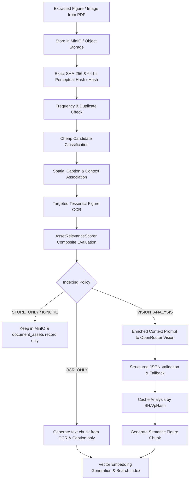

# Walkthrough — Intelligent Figure Relevance Classification & Selective Vision Analysis

## Overview
We implemented an intelligent classification, deduplication (SHA-256 + Perceptual Hash), and heuristic relevance scoring layer for document figures and visual assets in the RAG pipeline.

Instead of sending every visual candidate to expensive vision models or blindly indexing decorative images, the system intelligently scores each candidate, stores all original images non-destructively in MinIO for provenance, and applies policy-driven selective analysis.

---

## Architectural Workflow



---

## Changes Implemented

### 1. Data Models & Database Schema
- [**`src/rag/core/models.py`**](file:///home/inx/Documents/INX%20Projects/RAG/src/rag/core/models.py):
  - Added `IndexingPolicy` enum: `IGNORE`, `STORE_ONLY`, `OCR_ONLY`, `VISION_ANALYSIS`, `FULL_MULTIMODAL`.
  - Expanded `AssetType` enum: `FIGURE`, `DIAGRAM`, `ARCHITECTURE_DIAGRAM`, `FLOWCHART`, `TECHNICAL_DRAWING`, `CHART`, `GRAPH`, `PHOTO`, `PORTRAIT`, `ILLUSTRATION`, `TABLE_IMAGE`, `EQUATION_IMAGE`, `SCREENSHOT`, `LOGO`, `WATERMARK`, `ICON`, `SIGNATURE`, `DECORATIVE`, `UNKNOWN`.
  - Updated `DocumentAssetSchema` to include `perceptual_hash`, `relevance_score`, `relevance_reason`, `indexing_policy`, `processing_error`.
- [**`src/rag/core/db_models.py`**](file:///home/inx/Documents/INX%20Projects/RAG/src/rag/core/db_models.py):
  - Updated `DocumentAsset` ORM model with `perceptual_hash`, `relevance_score`, `relevance_reason`, `indexing_policy`, `processing_error` and database indexes.
- [**`src/rag/core/migrate.py`**](file:///home/inx/Documents/INX%20Projects/RAG/src/rag/core/migrate.py):
  - Added idempotent column migrations for `document_assets` on both PostgreSQL and SQLite.

### 2. Configuration System
- [**`src/rag/core/config.py`**](file:///home/inx/Documents/INX%20Projects/RAG/src/rag/core/config.py):
  - Added `RelevanceWeightsConfig` and updated `AssetConfig` with thresholds (`analyze_threshold=0.65`, `store_only_threshold=0.35`, `ocr_only_threshold=0.50`), `max_vision_calls_per_document=20`, `dedup_enabled=True`, `perceptual_hash_enabled=True`, and configurable scoring weights.
- [**`configs/config.json`**](file:///home/inx/Documents/INX%20Projects/RAG/configs/config.json):
  - Configured default relevance and threshold weights.

### 3. Deduplication & Intelligence Domain
- [**`src/rag/assets/deduplicator.py`**](file:///home/inx/Documents/INX%20Projects/RAG/src/rag/assets/deduplicator.py) *(NEW)*:
  - Exact SHA-256 byte hashing.
  - Pure-PIL 64-bit Perceptual Difference Hash (`dHash`) invariant to scaling and minor compression variations.
  - Hamming distance calculation and frequency tracking across document pages.
  - Deduplication cache allowing duplicate visual occurrences to reuse previous Vision and OCR analyses.
- [**`src/rag/assets/relevance.py`**](file:///home/inx/Documents/INX%20Projects/RAG/src/rag/assets/relevance.py) *(NEW)*:
  - `AssetRelevanceScorer` evaluates base score by visual type, caption presence, explicit figure label patterns, OCR token count, technical terminology keywords, page coverage, section context, and applies penalties for repeated logos, watermarks, and icons.
  - Determines policy routing: `VISION_ANALYSIS`, `OCR_ONLY`, `STORE_ONLY`, `IGNORE`.
- [**`src/rag/assets/classifier.py`**](file:///home/inx/Documents/INX%20Projects/RAG/src/rag/assets/classifier.py):
  - Enhanced cheap candidate classifier covering all asset types, geometry filters, aspect ratios, and contextual cues.
- [**`src/rag/assets/providers/openrouter_vision.py`**](file:///home/inx/Documents/INX%20Projects/RAG/src/rag/assets/providers/openrouter_vision.py) & [**`base.py`**](file:///home/inx/Documents/INX%20Projects/RAG/src/rag/assets/providers/base.py):
  - Enriched prompt with document title, section heading, caption, nearby text, and OCR labels.
  - Validated structured responses with graceful model fallback and contextual offline fallback.
- [**`src/rag/assets/chunker.py`**](file:///home/inx/Documents/INX%20Projects/RAG/src/rag/assets/chunker.py):
  - Added `is_indexable()` filter so only assets with indexable policies produce searchable text chunks for embedding, while preserving non-indexable assets in MinIO and DB metadata.
- [**`src/rag/assets/processor.py`**](file:///home/inx/Documents/INX%20Projects/RAG/src/rag/assets/processor.py):
  - End-to-end coordinator tracking operational metrics (`total_extracted`, `stored_minio`, `duplicates_detected`, `ocr_processed`, `vision_analyzed`, `store_only`, `ignored`, `embedded_chunks`, `vision_failures`).

### 4. Pipeline Integration
- [**`src/rag/ingestion/pipeline.py`**](file:///home/inx/Documents/INX%20Projects/RAG/src/rag/ingestion/pipeline.py):
  - Passed document title, section headings, and surrounding paragraph context to asset extraction.
  - Persisted all new relevance and perceptual hash columns to `DocumentAsset`.
  - Added structured summary log output for asset metrics per document.

---

## Verification & Test Results

All **211 automated tests** passed:
```
tests/test_advanced_tables.py ................                           [  7%]
tests/test_assets_analyzer.py ..                                         [  8%]
tests/test_assets_caption.py ...                                         [  9%]
tests/test_assets_classification.py ......                               [ 12%]
tests/test_assets_deduplication.py ....                                  [ 14%]
tests/test_assets_extraction.py ..                                       [ 15%]
tests/test_assets_ocr.py .                                               [ 16%]
tests/test_assets_openrouter.py ...                                      [ 17%]
tests/test_assets_pipeline_integration.py .                              [ 18%]
tests/test_assets_relevance.py ....                                      [ 19%]
tests/test_assets_selective_vision.py ...                                [ 21%]
tests/test_assets_storage.py ..                                          [ 22%]
tests/test_config.py ............                                        [ 27%]
tests/test_connectors.py .....                                           [ 30%]
tests/test_embeddings_idempotency.py ..                                  [ 31%]
tests/test_embeddings_pipeline_integration.py ...                        [ 32%]
tests/test_embeddings_provider.py .......                                [ 36%]
tests/test_embeddings_service.py .....                                   [ 38%]
tests/test_embeddings_validation.py .......                              [ 41%]
tests/test_incremental_ingestion.py ....                                 [ 43%]
tests/test_language_detection.py ........                                [ 47%]
tests/test_models.py ...                                                 [ 48%]
tests/test_normalization.py .......................                      [ 59%]
tests/test_ocr.py .............                                          [ 65%]
tests/test_parsing.py ..................                                 [ 74%]
tests/test_raw_storage.py ......................................         [ 92%]
tests/test_table_processing.py ................                          [100%]

============================= 211 passed in 19.81s =============================
```
